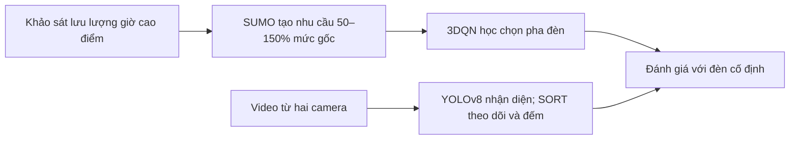
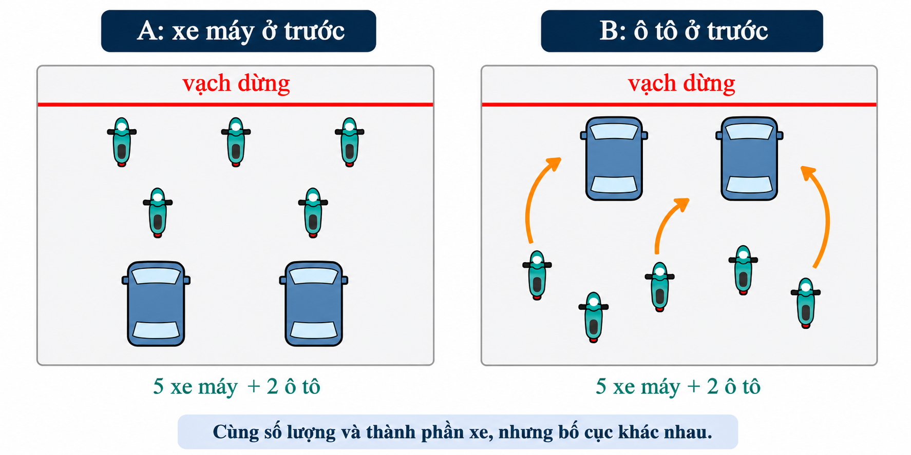
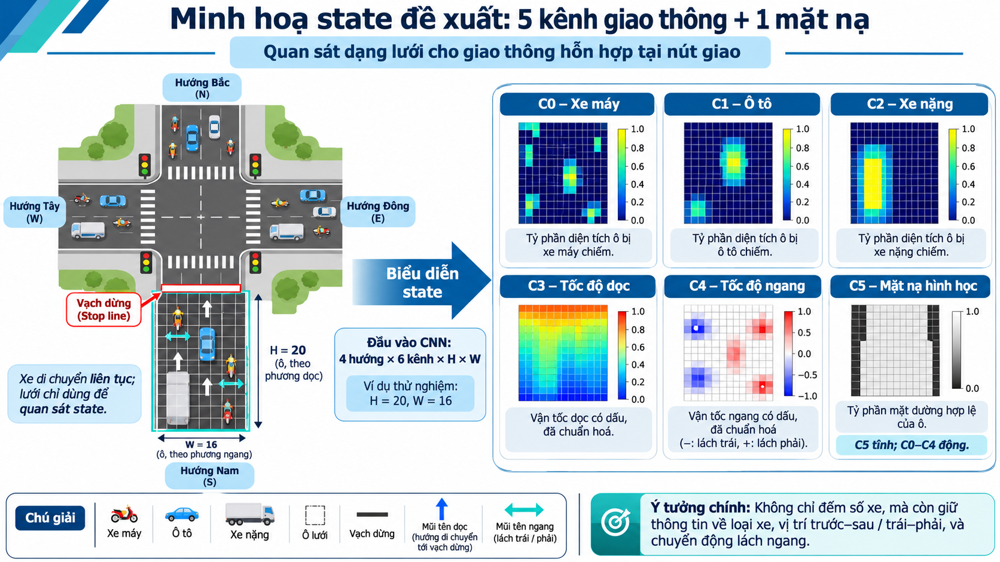
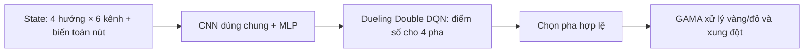
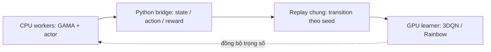

# ĐIỀU KHIỂN ĐÈN GIAO THÔNG THEO PHÂN BỐ KHÔNG GIAN VÀ LÁCH NGANG CỦA XE

**I. Bài báo đã có**  
**II. Ý tưởng nghiên cứu**  
**III. Kế hoạch triển khai**

# I. Bài báo đã có

## 1. Dữ liệu, mô phỏng và cách train

**Train:** Tác giả lấy lưu lượng xe từ khảo sát giao thông Đà Nẵng năm 2022 làm mức cơ sở. SUMO mô phỏng nhu cầu ngẫu nhiên bằng **50–150%** mức này để huấn luyện mạng **3DQN** chọn pha đèn. [1]

**Đánh giá:** Tác giả so sánh 3DQN đã train với đèn hoạt động theo lịch cố định trong SUMO. Ngoài các kịch bản lưu lượng ngẫu nhiên, họ dùng video từ **hai camera ở hai hướng vào nút giao**; YOLOv8 nhận diện, SORT theo dõi và đếm xe theo loại, hướng đi để tạo lưu lượng đầu vào. Kết quả được so sánh theo độ trễ và thời gian chờ. [1]



**Hình 1.** Hai luồng dữ liệu trong nghiên cứu Đà Nẵng; sơ đồ tự vẽ theo phương pháp bài báo. [1]

## 2. State, action và thuật toán

**State** được chia thành các ô và xếp thành ba lớp: **P** cho biết ô nào có xe (1 hoặc 0), **V** ghi tốc độ xe đã chuẩn hóa, **S** cho biết hướng đó đang được đi hay phải dừng theo đèn (1 hoặc 0). Ba lớp **P–V–S** được đưa vào CNN để 3DQN nhận biết xe ở đâu, chạy nhanh thế nào và có được đi không. [1]

![Hình 2. Ví dụ state P–V–S của một hướng giao thông; ảnh do người dùng cung cấp. [1]](figures/state_pvs_user.png)

**Action:** Mỗi lần ra quyết định, 3DQN chọn **giữ đèn xanh hiện tại** hoặc **chuyển sang pha xanh khác**. Khi đổi pha, đèn phải qua vàng và một khoảng đỏ ngắn trước khi hướng mới được đi. Bài báo mô tả cách điều khiển với **2 hoặc 4 pha**, rồi so kết quả với **đèn cố định theo chu kỳ 3 pha**. Vì số pha khác nhau, khi làm lại thí nghiệm cần ghi rõ mỗi pha cho hướng nào đi. [1]

```mermaid
flowchart LR
  A[State DTSE: P / V / S] --> B[CNN 16, 4×4, stride 2]
  B --> C[CNN 32, 2×2, stride 1]
  C --> D[FC 128 → FC 64]
  D --> E[Value V(s)]
  D --> F[Advantage A(s,a)]
  E --> G[Q(s,a) và chọn pha]
  F --> G
```

**Hình 3.** Kiến trúc và kích thước lớp mà bài báo công bố; hình tự dựng. [1][2]

Hai nhánh value và advantage tạo $Q(s,a)=V(s)+A(s,a)-\overline{A}(s)$. Double DQN dùng mạng online chọn action ở state tiếp theo và mạng target định giá. Bài báo nêu Adam $10^{-4}$, Huber loss, $\gamma=0{,}99$, replay tối đa $10^6$ transition, warm-up $10^5$, cập nhật target mềm $10^{-3}$. Hai checkpoint **1 triệu** và **5 triệu** bước được đem đánh giá. Reward trong bài báo tham chiếu chi tiết tới phương pháp Ducrocq–Farhi; khi tái lập phải công bố rõ công thức reward và chuẩn hóa đã dùng. [1][2]

## 3. Benchmark và kết quả

Tác giả lưu mô hình ở mốc **1 triệu** và **5 triệu bước**. Điểm thưởng bắt đầu tăng và bớt dao động từ khoảng **1,5 triệu bước**, rồi ổn định rõ trong khoảng **3–5 triệu bước**; vì vậy mô hình 5M đã học ổn định hơn mô hình 1M. [1]

**Đánh giá:** Tác giả cho SUMO chạy **1.000 giờ giao thông mô phỏng** với lưu lượng 50–150% mức nền để so hai mô hình đã train với đèn cố định. Mô hình 5M có **750** trường hợp độ trễ dưới 5 phút, so với **550** của 1M. Khi chỉ quan sát được một phần xe kết nối (CV), 5M đạt thời gian chờ trung bình dưới 5 phút từ khoảng **20% CV**; 1M cần trên **40% CV**. [1]

Để kiểm tra theo giao thông thực tế, tác giả lấy lưu lượng từ camera trong 12 giờ (06:00–18:00), đưa vào SUMO và so mô hình **3DQN 5M** với phương án đèn đặt thời gian cố định (fixed-time). Lúc 06:00, độ trễ 3DQN khoảng 7–8 phút; đến 10:00 giảm còn khoảng 2 phút. Buổi chiều, 3DQN giữ độ trễ quanh 4–6 phút, trong khi fixed-time tăng mạnh vào giờ cao điểm. [1]

| Thời điểm | 3DQN 5M, độ trễ (phút) | Fixed-time, độ trễ (phút) |
|---|---:|---:|
| 06:00 | ≈7,5 | ≈4,5 |
| 10:00 | ≈2 | ≈12,5 |
| 12:00 | ≈5 | ≈14 |
| 14:30 | ≈6 | ≈14 |
| 15:30 | ≈5 | ≈6 |
| 17:00 | ≈4,5 | ≈16 |

*Các điểm được dựng xấp xỉ từ mô tả kết quả; bài báo không cung cấp bảng số chi tiết.*

**Hình 4.** So sánh độ trễ theo thời điểm trong ngày. Các điểm được dựng xấp xỉ từ mô tả kết quả của bài báo; bài báo không cung cấp bảng số chi tiết. [1]

# II. Ý tưởng nghiên cứu

## 1. Ý tưởng cốt lõi

**Câu hỏi nghiên cứu:** Nếu hai hàng chờ có cùng số lượng và loại phương tiện, liệu vị trí sắp xếp xe (trước–sau, trái–phải) và khả năng lách của xe máy có ảnh hưởng đến số xe đi qua nút giao trong 5–20 giây, từ đó làm thay đổi quyết định điều khiển đèn giao thông tối ưu hay không?

Ý tưởng cốt lõi của nghiên cứu dựa trên ba ý chính sau:

| H1 — State theo không gian | H2 — Xe máy lách ngang | H3 — So sánh thuật toán |
|---|---|---|
| Vị trí và loại xe giúp dự đoán khả năng giải phóng hàng chờ. | Vận tốc ngang mô tả xe máy nhập khe và bổ sung thông tin cho state. | Trên cùng state, so Rainbow DQN và 3DQN + Max Pressure với 3DQN thuần. |

**Trình tự:** kiểm chứng H1 và H2 trước, sau đó mới đánh giá H3.

**Hình 5.** Ba ý tưởng chính dẫn dắt nghiên cứu.



## 2. State đề xuất: 5 kênh giao thông + 1 mặt nạ

Mỗi hướng tiếp cận được mã hóa thành lưới $H{\times}W$ theo chiều dọc và ngang đường. Xe vẫn di chuyển liên tục trong GAMA; lưới chỉ dùng làm quan sát. Với bốn hướng, đầu vào CNN là **$4{\times}6{\times}H{\times}W$**. Bản nháp chọn $H=20$, $W=16$ để thử, sau đó chốt theo hình học GAMA và độ phân giải dữ liệu. [4]

| **Kênh** | Giá trị từng ô | Ý nghĩa |
|:---|:---|:---|
| **C0** | Diện tích footprint xe máy / diện tích ô | Xe nhỏ ở trước, xen kẽ, trong khe. |
| **C1** | Diện tích footprint ô tô / diện tích ô | Vị trí vật cản lớn trên mặt cắt. |
| **C2** | Diện tích footprint xe nặng / diện tích ô | Xe buýt; xe tải chỉ thêm sau khi có hành vi phù hợp. |
| **C3** | Tốc độ dọc có dấu, chuẩn hóa | Xe đứng yên, đang bò hay tới vạch. |
| **C4** | Tốc độ ngang có dấu, chuẩn hóa | Xe máy đang lách trái/phải và nhập khe. |
| **C5** | Tỷ phần mặt đường hợp lệ của ô | Mặt nạ hình học tĩnh, không phải kênh xe. |

Đặc tả state nghiên cứu: C0–C4 động, C5 tĩnh. [4]



## 3. Cấu trúc điều khiển và hai hướng thuật toán

**Bước 1 — mô hình nền.** Trước tiên, dùng 3DQN để ánh xạ state thành điểm số cho bốn pha đèn: Bắc–Nam đi thẳng, Bắc–Nam rẽ trái, Đông–Tây đi thẳng, Đông–Tây rẽ trái. CNN dùng chung đọc lưới của từng hướng; MLP đọc các biến toàn nút. Nhánh Dueling Double DQN chấm điểm từng pha, rồi agent chọn pha hợp lệ có điểm cao nhất. GAMA đảm bảo chuyển pha an toàn bằng vàng, đỏ và loại các pha xung đột. [4]



**Hình 8.** Luồng điều khiển của 3DQN nền trước khi thử hai hướng cải tiến.

**Hướng A — 3DQN + Max Pressure.** 3DQN ước lượng pha nào có lợi về lâu dài. Max Pressure xét cả hàng chờ và chỗ trống phía sau nút: chẳng hạn, hướng Bắc có 30 xe nhưng đường ra đang tắc, còn hướng Đông có 20 xe và đường ra thông thoáng; khi đó hướng Đông có thể giải phóng được nhiều xe hơn. Với mỗi pha $a$, tính:
$$
S(a)=z_Q(s,a)+\lambda z_P(s,a), \qquad
P(s,a)=\sum_{m\in a}\mu_m(q_m^{in}-q_m^{out}).
$$
Trong đó $q^{in}$ và $q^{out}$ là số xe chờ trước và sau nút giao; $\mu_m$ là hệ số phục vụ. Chuẩn hóa hai điểm trước khi cộng; $\lambda$ điều chỉnh mức ảnh hưởng của Max Pressure.

| Pha đèn | Điểm 3DQN $z_Q$ | Điểm Pressure $z_P$ | Tổng điểm ($\lambda=0{,}5$) |
|:--:|:--:|:--:|:--:|
| A | 0,8 | 0,2 | 0,90 |
| B | 0,6 | 0,9 | 1,05 |

Ví dụ minh họa: 3DQN thuần chọn A, còn điểm kết hợp chọn B. Các số chỉ để minh họa, không phải kết quả thực nghiệm.

Đánh giá hướng A với cả 3DQN thuần và Max Pressure thuần để tách đóng góp của từng cách.

**Hướng B — Rainbow DQN.** Rainbow không thêm luật chọn đèn; nó nâng cấp cách mạng học từ trải nghiệm. State, bốn pha và hàm thưởng được giữ như 3DQN nền.

| **Kỹ thuật** | Tác dụng dễ hiểu |
|:---|:---|
| **PER** | Lấy lại thường xuyên hơn những tình huống mạng đang dự đoán sai nhiều. |
| **$n$-step** | Tính đến phần thưởng của nhiều quyết định tiếp theo, không chỉ kết quả ngay sau một lần đổi đèn. |
| **C51** | Ước lượng nhiều kết quả tương lai có thể xảy ra thay vì chỉ một giá trị trung bình. |
| **NoisyNet** | Thêm nhiễu vào mạng để agent thử các lựa chọn khác nhau và khám phá cách điều khiển mới. |

Bốn thành phần Rainbow được đề xuất để thử. [3]

Ví dụ, đổi đèn có thể làm tăng thời gian chờ ngay lúc chuyển pha vì phải qua vàng và đỏ, nhưng giúp giảm ùn tắc sau 20–30 giây. Học $n$-step giúp tính đến kết quả đến muộn này; PER giúp agent học lại những tình huống khó. Rainbow chuẩn cũng gồm Double DQN và Dueling Network, vốn đã có trong mô hình nền. Prototype hiện có chỉ xuất hai pha, nên cần mở rộng thành bốn pha và lọc các pha xung đột. [3][4]

## 4. Bốn hàm thưởng tiềm năng

Reward cộng các mức phạt trong mỗi bước quyết định $\Delta t$, kể cả thời gian vàng và đỏ. Phạt càng âm thì tình trạng giao thông càng kém; agent học cách giảm tổng mức phạt.

1.  **R1 — Giảm tổng thời gian xe trong hệ thống**

    $\displaystyle R_1=-\frac{1}{D_{\mathrm{ref}}}\int_t^{t+\Delta t}(N_{\mathrm{road}}+N_{\mathrm{ext}})\,d\tau$

    Phạt thời gian mọi xe còn trong mạng, đồng thời tính cả xe đang chờ được đưa vào mô phỏng.

2.  **R2 — Giảm thời gian xe đang dừng**

    $\displaystyle R_2=-\frac{1}{W_{\mathrm{ref}}}\int_t^{t+\Delta t}(Q_{\mathrm{stop}}+\lambda N_{\mathrm{ext}})\,d\tau$

    Gần với cách tính thời gian chờ hiện tại; dễ triển khai nhưng có thể bỏ qua xe bò chậm mà chưa dừng.

3.  **R3 — Giảm tràn hàng ở đường ra**

    $\displaystyle R_3=R_1-\frac{\beta}{B_{\mathrm{ref}}}\int_t^{t+\Delta t}B_{\mathrm{out}}\,d\tau$

    Dùng R1 rồi phạt thêm khi đường ra bị chặn kín, khiến hàng xe dồn ngược vào nút giao.

4.  **R4 — Phạt xe chạy chậm so với tốc độ mong muốn**

    $$
    R_4(t)=-\frac{1}{D_{\mathrm{ref}}}
    \sum_{\tau\in[t,t+\Delta t)}\sum_{v\in S(\tau)}
    \omega_{k(v)}\left[1-\min\!\left(1,\frac{s_v(\tau)}{s_v^{\mathrm{des}}}\right)\right]\Delta\tau.
    $$
    Ở mỗi tick, xe chạy càng chậm hơn tốc độ mong muốn thì bị phạt càng nhiều; $\omega_{k(v)}$ tăng hoặc giảm ảnh hưởng theo loại xe (ví dụ PCU). Công thức tính cả xe đang chờ sinh vào mạng.

Trong R1–R3, $N_{\mathrm{road}}$ là xe đã vào mạng, $N_{\mathrm{ext}}$ là xe đang chờ được đưa vào, $Q_{\mathrm{stop}}$ là xe dừng và $B_{\mathrm{out}}$ là mức nghẽn đường ra. Trong R4, $\Delta\tau$ là một tick mô phỏng, $\Delta t$ là một bước quyết định, $s_v$ là tốc độ hiện tại và $s_v^{\mathrm{des}}$ là tốc độ mong muốn. $D_{\mathrm{ref}}$ lấy từ độ trễ trung bình mỗi bước của đèn fixed-time với cùng lưu lượng; $W_{\mathrm{ref}}$ và $B_{\mathrm{ref}}$ là hệ số chuẩn hóa cố định. Chọn $\lambda$ và $\beta$ trên validation.

# III. Kế hoạch triển khai

## 1. Luồng tính toán

Mỗi **CPU worker** chạy một GAMA Headless/JVM và GAMA Server, mô phỏng xe, đường, lách ngang và tín hiệu. Python qua WebSocket lấy snapshot, tạo tensor, chọn action và lưu transition. **GPU learner** PyTorch lấy minibatch từ replay để cập nhật 3DQN/Rainbow; actor dùng bản policy CPU cố định trong một đợt episode, nhận trọng số mới ở đợt sau. GPU chỉ tăng tốc phần learner; tốc độ toàn pipeline còn phụ thuộc GAMA, CPU, RAM và giao tiếp. [4]



**Hình 9.** Pipeline GAMA CPU và learner GPU; hình tự dựng theo mã dự án. [4]

## 2. Địa điểm và thời lượng train dự kiến

Địa điểm nghiên cứu là **nút giao Lê Văn Lương – Vành Đai 2.5**; hình học nút, các hướng xe và nhu cầu giao thông sẽ được dựng trong GAMA để làm môi trường mô phỏng. Dự kiến chạy mô phỏng GAMA trên CPU và huấn luyện mạng PyTorch trên GPU trong **Google Colab**. Trước tiên chạy thử mốc 1 triệu bước quyết định để đo tốc độ thực tế, sau đó train đến tối đa 5 triệu bước và đánh giá trên các kịch bản đã tách riêng. Dự kiến dành khoảng **1–2 tuần** cho các lượt chạy train và đánh giá; đây là thời lượng kế hoạch, sẽ điều chỉnh theo tốc độ GAMA và tài nguyên Colab được cấp.

## 3. Phân công công việc

- **Khải:** dựng và kiểm tra mô phỏng giao thông trong GAMA; xây dựng pipeline state–action–reward; thực hiện toàn bộ quá trình train và đánh giá các thuật toán.

- **Thành và Phong:** quay video tại nút giao; fine-tune mô hình nhận diện phương tiện; nhận diện, đếm và phân loại xe từ video để tạo dữ liệu benchmark.
